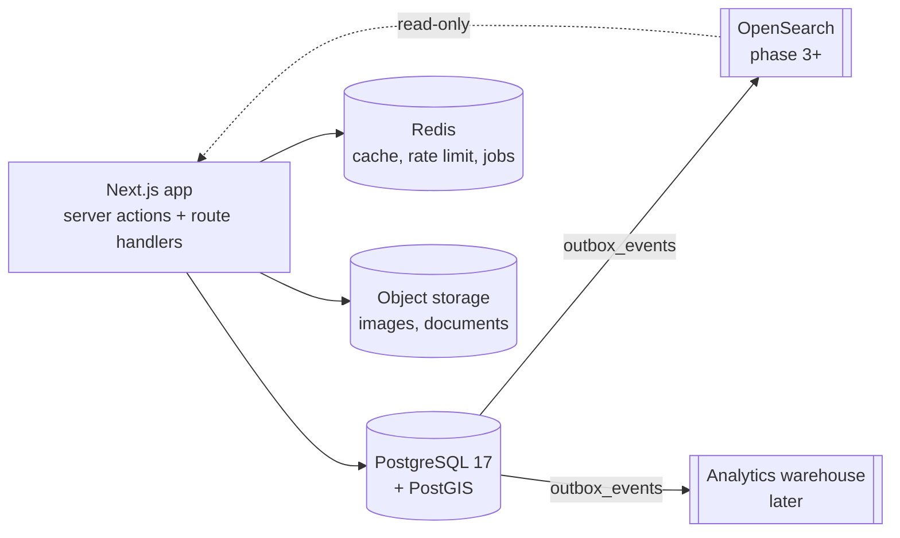

# 2. Proposed architecture

## 2.1 Stack

| Layer | Choice | Role |
| --- | --- | --- |
| System of record | **PostgreSQL 17** | All authoritative transactional data |
| Spatial | **PostGIS 3.5** (`postgis/postgis:17-3.5`) | Points, boundaries, radius/viewport/containment queries |
| Cache, rate limits, locks, jobs | **Redis** | Never authoritative; everything in it is reconstructible |
| Files | **S3-compatible object storage** | Binaries; Postgres stores only metadata |
| Search (later) | **OpenSearch**, fed from an outbox | Derived index; rebuildable from Postgres at any time |
| Analytics (later) | Warehouse fed from the same outbox | Derived |

One database, one schema-per-domain layout, one deployable application (a modular monolith). No microservices,
no event sourcing, no vector store, no message broker until a real constraint demands one.

Extensions: `postgis`, `pg_trgm` (fuzzy name matching), `citext` (emails), `btree_gist` (exclusion constraints
for lease/booking overlaps), `pgcrypto`, `ltree` (place hierarchy).



## 2.2 Domain map (Postgres schemas)

Each domain is a Postgres schema and an application module. Cross-domain foreign keys are allowed, but only
*downhill*: a domain may depend on those above it, never below.

```
platform      audit_events, outbox_events, feature_flags, system_settings
identity      users, sessions, accounts, verifications, rate_limits   (built: phase 0)
orgs          organizations, memberships, roles, permissions, role_permissions
geography     places, addresses
real_estate   properties, property attribute tables, projects, buildings, unit_types, media
marketplace   listings, listing_prices, saved_*, property_views, enquiries
crm           contacts, leads, lead_activities, tasks, pipeline_stages, visits
trust         verification_cases, verification_checks, trust_scores, valuations
comms         conversations, conversation_participants, messages, notifications
deals         transactions, offers, transaction_parties, documents, signatures, payments
tenancy_mgmt  leases, rent_charges, rent_payments, maintenance_requests, vendors
finance       provider-backed abstractions only (phase 5+)
```

## 2.3 The core model

Six nouns. If these are right, everything else is an attachment.

```
PERSON --< MEMBERSHIP >-- ORGANIZATION
                               |
PLACE --< ADDRESS --< PROPERTY --< LISTING --< OFFER --< TRANSACTION
                          |            |
                     attributes    price history
                  media, trust, valuation
```

**Property is the spine.** It is created once, corrected over time, and never deleted. Listings, leads, visits,
offers, transactions, leases and scores all hang off it. This is what makes a Property Passport possible: the
Passport is a *query over structured rows*, not a table and certainly not a JSON blob.

## 2.4 Decisions, including where I disagree with the brief

The brief asked to be challenged. Ten decisions follow; four are disagreements with the brief, and D10 adds PGs.

### D1 — Property is not Listing. Agreed, keep separate.

Non-negotiable, and the most important rule here. Two brokers listing the same flat at different prices are two
`listings` rows against one `properties` row. Price history, trust, valuation and visit history belong to the
property and must outlive any individual listing.

**What the brief misses:** if the same flat arrives three times from three brokers, you get three *property*
rows unless you plan for it. Marketplaces live or die on this. Proposed from day one:

- `properties.source` (`user_submitted` / `org_submitted` / `import` / `verified`) and `properties.confidence`
- A natural key where one exists: unique `(building_id, unit_number)` when both are present
- `property_merges (surviving_id, merged_id, merged_by, reason, created_at)` so a merge is auditable and reversible

Without this, duplicate listings silently become duplicate properties and every downstream metric is wrong.

### D2 — `units` as a table separate from `properties`. Disagree: merge them.

The brief's own rule forbids duplicate representations of one business concept, and `unit` versus `property` is
exactly that. Unit 1204 *is* the property. Two tables means every query joins twice and every write must decide
which row is canonical.

| Option | Trade-off |
| --- | --- |
| A. Separate `units` and `properties` | Matches the brief literally. Costs a permanent join, creates an ambiguous "which row is the truth" question, and duplicates area, floor and facing on both sides |
| **B (recommended).** `properties` carries `project_id`, `building_id`, `floor_number`, `unit_number`; a `unit_types` table holds the reusable floor plan | One row per physical asset. Developer inventory becomes `properties.inventory_status`. `unit_types` ("3BHK Type A, 1848 sqft") is where repeated attributes live, so 400 identical flats do not duplicate a floor plan 400 times |

Option B models everything the brief wants with one less level and no ambiguity.

### D3 — `floors` as a table. Disagree: drop it.

A floor has no attributes beyond its number. A table buys a join and millions of near-empty rows. Store
`floor_number smallint` plus optional `floor_label` ("G", "LG", "14A" — many Indian towers skip 13) on the
property. If floor-plate data ever matters, `building_floors` can be added later without touching properties.

### D4 — Six geography tables. Disagree: one `places` table.

The brief proposes `countries → states → cities → localities → sub_localities → neighborhoods`. Indian geography
does not divide that cleanly: micro-markets overlap, localities nest inside localities, and a name like
Gachibowli behaves as city-adjacent, locality and micro-market depending on who is speaking.

| Option | Trade-off |
| --- | --- |
| A. Six tables | Strong typing, but six joins for a breadcrumb, a fixed depth, and a schema change every time a new level appears |
| **B (recommended).** One `places` table: `id, parent_id, place_type, name, slug, path ltree, centroid geography(Point), boundary geometry(MultiPolygon)` | Arbitrary depth, one recursive query for "everything inside Hyderabad", indexed ancestor/descendant lookups via `ltree`, and new level types become data rather than DDL |

Typing is preserved with a `place_type` enum plus a check constraint on legal parent/child pairs. This table is
very painful to split later, so it is worth settling now.

### D5 — `addresses.property_id`. Disagree: invert it.

The brief puts `property_id` on the address, but organizations, projects and contacts need addresses too. That
shape forces either duplicate address tables or a nullable column per owner type.

Recommended: `addresses` stands alone (line1, line2, landmark, postal_code, place_id, `location
geography(Point,4326)`), and owners hold `address_id`. Property to address stays effectively 1:1, enforced by a
unique index on `properties.address_id`.

### D6 — Individual sellers. Auto-create a personal organization.

An owner listing their own flat is not a brokerage, but if a listing can be owned by *either* a user or an org,
then every authorization check, CRM query and tenant filter needs two code paths forever. Creating a hidden
`personal` organization at signup costs one row and keeps tenancy to exactly one shape.

### D7 — RBAC. Agreed in structure, but permissions alone are insufficient.

`users / organizations / memberships / roles / permissions / role_permissions` is right. What is missing is
**scope**: "agent can view leads" is meaningless until you say *which* leads. An agent should see their own, a
team lead their team's, an owner the whole organization's.

Recommended additions:

- `role_permissions.scope` enum (`own` / `team` / `org` / `all`), resolved server-side into a query predicate
- Roles are org-scoped: `roles.organization_id NULL` marks a system template, cloned per organization
- A membership may hold several roles (`membership_roles`)
- Trustbrick staff powers live on `users.platform_role`, entirely separate from any organization
- Deny by default; every check runs server-side

### D8 — Media. One `media` table, but keep real foreign keys.

A purely polymorphic `(entity_type, entity_id)` pair cannot carry a foreign key, which contradicts the brief's
own integrity rule. Recommended: `media` holds the asset (storage key, mime, bytes, dimensions, checksum) and
`media_links` attaches it with one nullable FK per parent type plus
`CHECK (num_nonnulls(property_id, project_id, listing_id, unit_type_id, organization_id) = 1)`. Real referential
integrity, real cascade rules, and one asset can be attached in several places without re-uploading.

### D9 — Identifiers. UUIDv7 internally, opaque public IDs externally.

Random UUIDv4 primary keys scatter B-tree inserts and hurt at millions of rows. UUIDv7 is time-ordered, so
inserts stay index-local while remaining unguessable. Public URLs use a separate short opaque `public_id`
(`TB-PROP-7F3K2Q`, Crockford base32), so identifiers are neither enumerable nor tied to row internals.

### D10 — PGs. A listing type with its own terms, not a search filter.

"PGs for Men" and "PGs for Women" look like a filter on rentals, but a PG differs from a rental in structure, not
just labels:

- It is priced **per bed** (single, double, triple occupancy), not per property
- One property offers **several room configurations at different prices at the same time**
- It carries **operating rules**: gender policy, meals, food preference, notice period, lock-in, visitor rules
- Occupancy is **per bed**, so later tenancy management is bed-level, not unit-level

| Option | Trade-off |
| --- | --- |
| A. An ordinary `rent` listing with extra columns (`gender_policy`, `meals`, `rent_per_bed`, …) on `listings` | Quick, but every non-PG listing carries a set of permanently-NULL columns, and one listing still cannot express three room types at three prices |
| **B (recommended).** Model the physical space and the offer separately, like everything else | Physical: property type `pg` plus a 1:1 `pg_attributes` (rooms, beds, bathrooms). Offer: `listings.transaction_type = 'pg'`, a 1:1 `pg_listing_terms` (gender policy, meals, food, notice, lock-in, rules) and 1:N `pg_room_offers` (occupancy, rent per bed, deposit, beds available) |

**Gender policy lives on the listing, not the property.** It is the operator's policy, not a fact about the
building: a men's PG can reopen as a women's PG, and the property's history (and its Passport) must survive that
unchanged. This is the same Property ≠ Listing rule as D1, applied again.

**Never store a user's gender to make this work.** The hero's "PGs for Men / Women" becomes a search filter over
`pg_listing_terms.gender_policy`; it is not a profile field. Asking for and storing gender to filter search results
would be unnecessary personal data under the DPDP Act's data-minimisation principle, and it would also make the
filter feel like a gate rather than a choice.

**Search.** `listings.price` holds the lowest current `rent_per_bed` for PG listings, maintained in the same
transaction as `pg_room_offers` writes. That lets PGs sort and filter by price through the same index as every
other listing, instead of a special-case join on the hottest query path.

**Later.** When PG management arrives (phase 5), a `pg_beds` table makes occupancy bed-level, and a lease can
reference a bed. Nothing in the phase 2 tables has to change for that.

### Also worth stating

- **PostGIS is the right call.** Points as `geography(Point,4326)` give correct metre distances without picking
  a projection; boundaries as `geometry(MultiPolygon,4326)`, because polygon operations are markedly faster in
  `geometry`. Both get GiST indexes. Latitude and longitude are never stored as loose unrelated floats.
- **India-specific fields are first-class, not metadata.** RERA registration (`projects.rera_number`,
  `listings.rera_id`) is a legal display requirement in several states. Area is stored as **carpet, built-up and
  super built-up** separately — RERA mandates carpet area, and conflating the three is the most common data
  error in Indian portals.
- **Money** is `numeric(16,2)` with an explicit `currency char(3)` defaulting to `INR`. Never floats. Price,
  rent, deposit and maintenance are distinct columns, never one generic "amount".

## 2.5 Multi-tenancy

Three tiers of data, each with a different rule:

| Tier | Examples | Rule |
| --- | --- | --- |
| **Public** | properties, published listings, places, projects | Readable by anyone; writes restricted to the owning organization |
| **Tenant-private** | leads, contacts, activities, tasks, pipelines, documents | `organization_id NOT NULL`; never visible across organizations |
| **Personal** | saved properties, saved searches, view history | Scoped to `user_id`, invisible to any organization |

Enforcement, in order:

1. **Application layer is primary.** Every tenant-private query goes through a repository that takes
   `organization_id` from the session. Ad-hoc raw queries against these tables are a code-review blocker.
2. **Row-Level Security as defence in depth.** `SET LOCAL app.current_org_id` per transaction, with policies on
   tenant-private tables. Deliberate warning for implementation: with a transaction-mode pooler, `SET LOCAL`
   inside a transaction is correct and plain `SET` is not — getting this wrong leaks data between requests.
3. **Composite indexes lead with `organization_id`**, so isolation and performance point the same way.

RLS does not replace application authorization: it cannot express own/team/org scope, and the migration role
bypasses it.

## 2.6 Audit, soft delete and lifecycle

**Audit.** `audit_events` is append-only: `actor_user_id, organization_id, action, entity_type, entity_id,
before jsonb, after jsonb, ip_address, user_agent, created_at`. The application role is granted INSERT and
SELECT only — no UPDATE, no DELETE — so immutability is enforced by the database rather than by good intentions.
Monthly partitioning once volume justifies it. Audited: listing lifecycle and price changes, role and membership
changes, verification outcomes, lead reassignment, document access, offer and transaction state, payments.

**Soft delete, selectively.** `deleted_at` belongs on entities with history or legal weight: properties,
listings, leads, contacts, organizations, transactions, documents, verification records. It does **not** belong
on join tables, `saved_properties`, `property_views`, sessions or audit rows — there a hard delete is correct,
and a user un-saving a property should get a real delete. Soft-deleted tables get partial indexes
(`WHERE deleted_at IS NULL`), including partial unique indexes so a deleted row never blocks a new one.

**Lifecycle.** Listings expire rather than vanish (`status`, `expires_at`). Properties persist indefinitely.
Behavioural data (`property_views`) has a retention window and is aggregated before purge. Verification
documents carry a retention policy and are removed from object storage on expiry, leaving metadata and the audit
trail behind. Under India's DPDP Act, holding identity documents requires consent records, purpose limitation
and deletion on request, so `verification_documents` carries `retention_until` and `consent_id` from the start
rather than as a retrofit.

## 2.7 Search and derived data

Phases 1–2 use plain Postgres: a `tsvector` generated column with GIN for text, PostGIS GiST for map, radius and
containment, and B-tree/composite indexes for filters. That comfortably covers the first hundreds of thousands
of listings.

When that stops being enough, OpenSearch is fed from `outbox_events` written in the *same transaction* as the
business change. That is what keeps the index rebuildable and Postgres authoritative — no dual writes, no drift.
The same outbox later feeds analytics and any embedding index, which are equally derived.

Trust scores and valuations follow the same discipline: `trust_scores` and `valuations` are versioned rows
(`version`, `model_version`, `calculated_at`) with factor and comparable child rows — never a mutable column on
`properties`. A score must always be explainable from its factors, and an automated estimate is never presented
as a professional appraisal.

## 2.8 Scale

Designed for millions of properties and listings without sharding:

- UUIDv7 keys keep inserts index-local
- Keyset pagination throughout; never `OFFSET` on large result sets
- Append-only high-volume tables (`property_views`, `audit_events`, `messages`, `outbox_events`) are monthly
  partition candidates with BRIN indexes on `created_at`
- Hot filters get composite and partial indexes (see [04-tables.md](04-tables.md))
- Aggregates such as locality price per sqft are materialized views refreshed on a schedule, not computed
  per request
- Read replicas long before any thought of sharding

## 2.9 Risks and trade-offs

| Risk | Mitigation |
| --- | --- |
| **Over-building.** The full model is roughly 80 tables; an MVP needs about 20 | Phased plan with gates; a table is created only when a feature needs it |
| **Duplicate properties from multi-broker listings** | Matching key, `confidence`, and a reversible `property_merges` trail (D1) |
| **PostGIS operational cost** — the extension must exist in every environment | Pin `postgis/postgis:17-3.5` locally, and confirm the managed provider supports PostGIS *before* choosing it (Neon, Supabase and RDS all do) |
| **RLS plus connection pooling misuse leaking tenant data** | `SET LOCAL` only, inside a transaction, covered by an integration test asserting cross-tenant reads return zero rows |
| **JSONB creep** — flexible today, unqueryable tomorrow | Policy: JSONB only for provider payloads, AI extraction output and rare optional metadata. Anything filtered, sorted, joined or reported on is a typed column |
| **Derived data presented as fact** | Scores and valuations render only alongside their explanation rows |
| **Enum rigidity** | Native enums only for stable sets (listing status, transaction type); business-extensible sets such as `property_types` are lookup tables |
