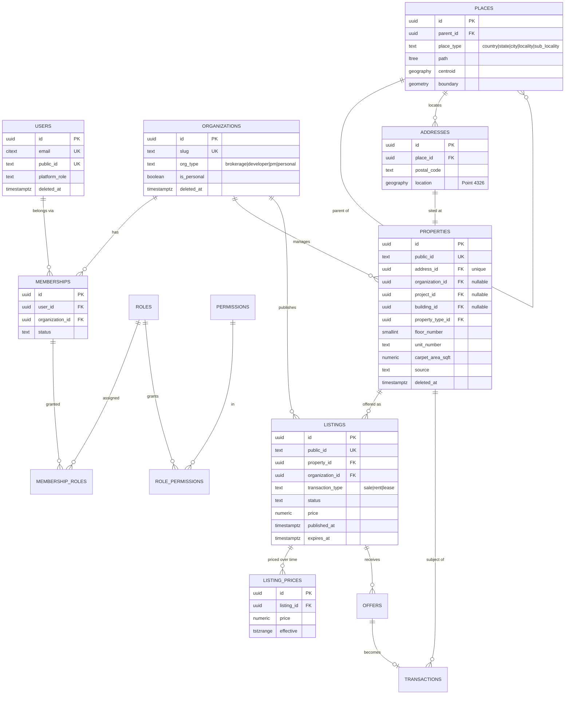
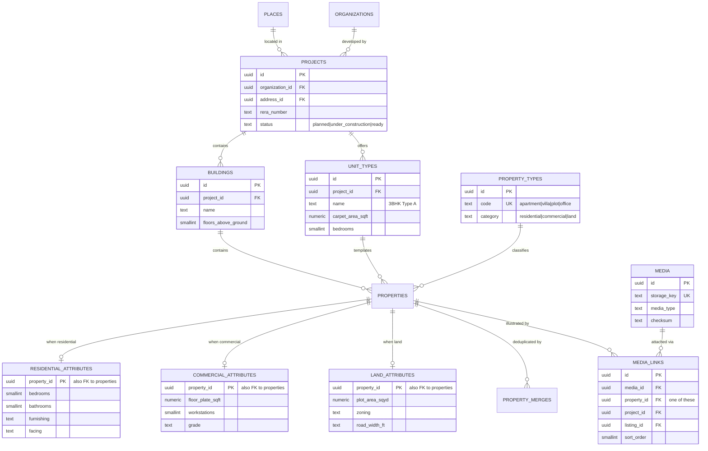
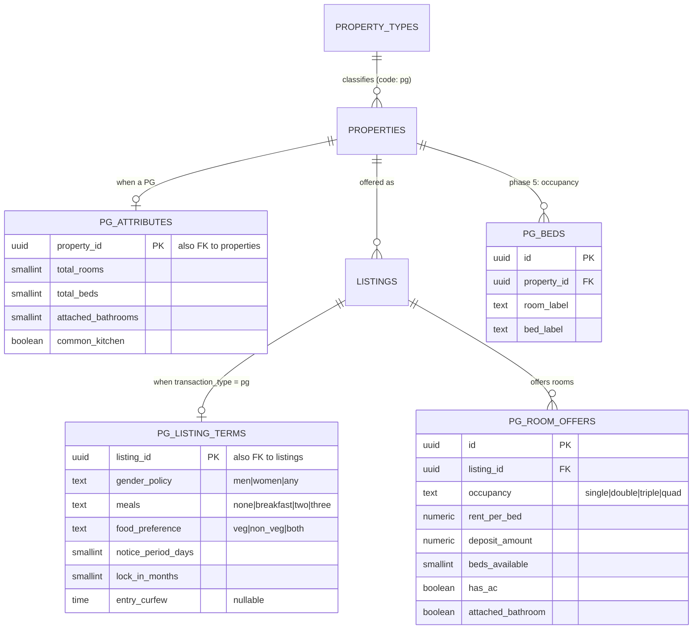
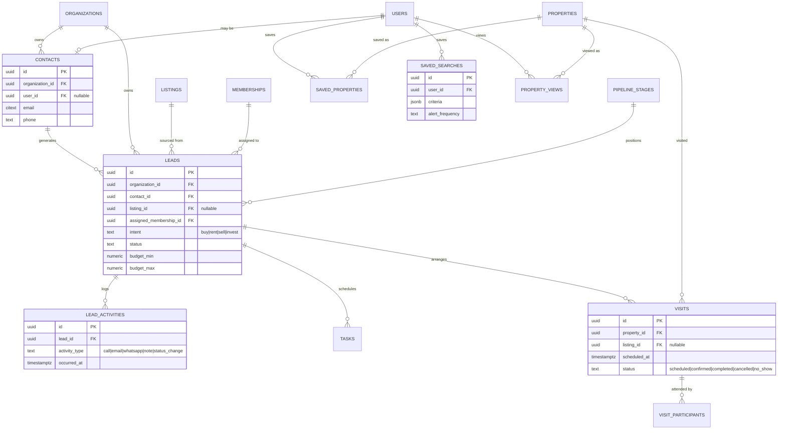
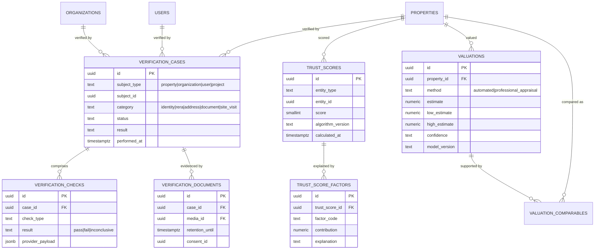
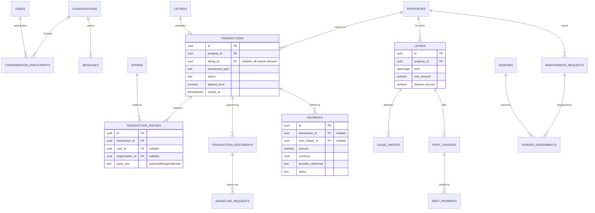

# 3. ERD

One giant diagram would be unreadable, so the model is drawn as a core ERD plus one per domain. Only key and
identifying columns are shown; the full column lists live in [04-tables.md](04-tables.md).

GitHub renders these Mermaid diagrams directly in the browser.

## 3.1 Core model

The six stable nouns and the spine that connects them.

## 3.2 Geography, projects and property detail

Note the merged unit model (decision D2) and the absent `floors` table (D3).

## 3.2a PGs (paying-guest accommodation)

The physical space and the market offer are separate, exactly as for any other property (decision D10). Gender
policy sits on the listing's terms, never on a user.

## 3.3 CRM, consumer and visits

A contact exists whether or not the person ever registers; `contacts.user_id` links them if they do.

## 3.4 Trust and intelligence

Everything here is derived and versioned. Nothing here is a column on `properties`.

## 3.5 Messaging, deals and property management

Drawn together because they share the transaction spine. All of this is phase 4+; it is shown to prove the core
model can carry it without change.

